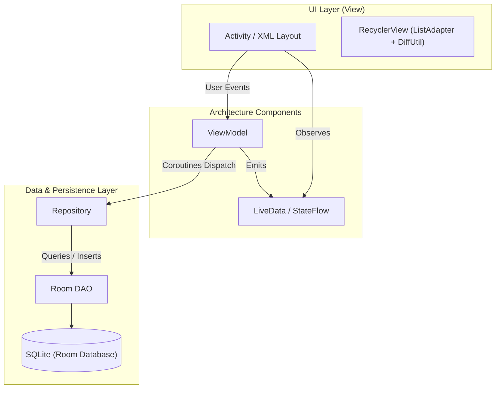

<div align="center">

# 🍃 Ruang Tenang
### *Digital Mood Tracker & Daily Journal Android Application*

[](https://kotlinlang.org/)
[](https://developer.android.com/)
[](https://developer.android.com/topic/architecture)
[](https://developer.android.com/training/data-storage/room)
[](https://m3.material.io/)
[](LICENSE)

<p align="center">
  Aplikasi Android *self-care* dan jurnal digital untuk mencatat perasaan harian, merefleksikan kegiatan emosional, memantau riwayat jurnal berbasis kalender, serta menganalisis pola mood secara berkala demi kesehatan mental yang lebih baik.
</p>

</div>

---

## 👥 Tim Pengembang

Proyek ini dikembangkan oleh:

| Nama | NIM | Peran Utama |
| :--- | :--- | :--- |
| **I Kadek Bintang Adi Bimantara** | `2405551049` | Core Feature, Architecture & Database |
| **Trio Suro Wibowo** | `2405551168` | UI/UX & Layout Implementation |
| **Richard Christian Mozart Diazoni** | `2405551019` | State Handling & Business Logic |
| **I Komang Cahya Kertha Yasa** | `2405551034` | Testing & Asset Optimization |

---

## 🏗️ Pola Arsitektur (MVVM Pattern)

Aplikasi dibangun dengan mematuhi prinsip arsitektur **Modern Android Development (MAD)** menggunakan pola **Model-View-ViewModel (MVVM)** yang *decoupled*, mudah diuji (*testable*), dan reaktif:



---

## ✨ Fitur Unggulan

* 🔐 **Otentikasi & Guest Mode**: Fleksibilitas masuk menggunakan akun terdaftar atau eksplorasi instan tanpa login via *Guest Mode*.
* 📖 **Jurnal Perasaan (Full CRUD)**:
  * Menulis, membaca detail, memperbarui, dan menghapus entri jurnal.
  * Tagging emosi dengan **9 representasi mood visual**: *Senang, Tenang, Netral, Sedih, Cemas, Marah, Malu, Takut, dan Malas*.
  * Penyimpanan data lokal yang cepat dan andal menggunakan **Room Database** (SQLite ORM).
* 🔍 **Pencarian Real-Time**: Pencarian cepat entri catatan berdasarkan kecocokan kata kunci pada judul maupun isi diary.
* 📅 **Kalender Riwayat Interaktif**: 
  * Pelacakan visual tanggal-tanggal yang memiliki catatan jurnal dalam satu bulan.
  * Aturan integritas waktu: pencatatan entri baru dikhususkan untuk hari ini (*real-time journaling*) guna menjaga keaslian refleksi emosi.
* 📊 **Analisis & Statistik Mood**: Visualisasi tren dan distribusi emosi 30 hari terakhir pada profil pengguna untuk *mood tracking awareness*.

---

## 🛠️ Tech Stack & Komponen Teknis

* **Bahasa**: [Kotlin 1.9+](https://kotlinlang.org/)
* **Arsitektur**: MVVM (ViewModel, LiveData, Lifecycle Runtime KTX)
* **Penyimpanan Lokal**: Android Jetpack [Room Database 2.6](https://developer.android.com/training/data-storage/room)
* **Komputasi Asinkron**: Kotlin Coroutines & Kotlin Flows
* **Optimasi List**: `RecyclerView` dengan `ListAdapter` dan `DiffUtil` untuk rendering efisien
* **Desain UI**: XML Layouts dengan Google Material Components 3 & ConstraintLayout
* **Parser Utilitas**: Google Gson 2.10

---

## 📱 Alur Layar Aplikasi

```
[Splash Screen] ──> [Login / Register / Guest] ──> [Beranda (Main Feed)]
                                                          │
          ┌───────────────────────────────────────────────┴───────────────────────────────┐
          ▼                                               ▼                               ▼
 [Tambah / Edit Diary]                           [Kalender Riwayat]              [Profil & Statistik]
 (Input Judul, Cerita & Mood)                    (Navigasi Bulanan)              (Distribusi Mood 30 Hari)
```

---

## ⚡ Panduan Menjalankan Proyek

### Prasyarat
* Android Studio (Koala / Ladybug atau versi terbaru)
* Android SDK (API Level 24+ / Android 7.0 Nougat ke atas)
* JDK 17

### Langkah Instalasi
1. **Clone Repositori:**
   ```bash
   git clone https://github.com/dekbintang/Ruang-Tenang.git
   cd Ruang-Tenang
   ```
2. Buka proyek di **Android Studio**.
3. Tunggu hingga proses **Gradle Sync** selesai secara otomatis.
4. Hubungkan perangkat fisik Android (aktifkan mode *USB Debugging*) atau jalankan Android Virtual Device (AVD).
5. Klik ikon **Run (▶️)** atau gunakan shortcut `Shift + F10`.

---

## 📄 Lisensi
Proyek ini dilisensikan di bawah [Lisensi MIT](LICENSE).

<div align="center">
  <i>Ruang Tenang — Ruang aman untuk merefleksikan setiap detik perasaanmu.</i>
</div>
